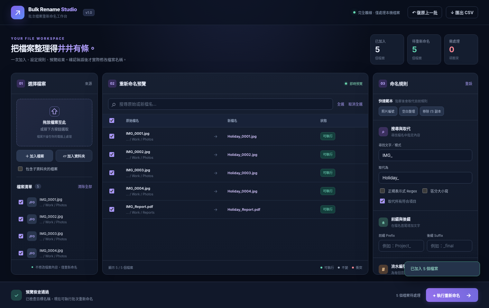

# Bulk File Studio

Bulk File Studio 是繁體中文 Windows 桌面工具，將檔案收藏、標籤、自訂資料工作區及批次檔案操作放在同一個應用程式。預設離線運作，使用者可另行啟用指定資料夾的共享資料包。

[安裝與使用](INSTALL.md) · [完整更新紀錄](CHANGELOG.md) · [浮動工具](docs/floating-panels.md) · [共享範圍與版本](docs/sharing-scope-and-versions.md)



*上圖為早期版本的示意畫面。*

## 近期更新

- **Excel 匯出**：在「資料工作區 → 資料操作」選「匯出篩選表格（Excel）」。每次匯出目前表格最多 1,000 筆篩選結果，可用「貼上／Excel 建立」預覽並新增紀錄。關聯與檔案連結請使用 Studio 資料包。
- **更新紀錄**：程式內「資訊 → 更新紀錄」先顯示最近版本，較早的紀錄可展開，也可按版本、日期或功能搜尋。[查看完整更新紀錄](CHANGELOG.md)
- **浮動工具**：日曆／看板與常用文字片段快捷動作可選在浮動工具內、外部選單或主視窗開啟。月曆以徽章標示有行程的日期，點選日期開啟當日清單。點文字片段即可複製。[設定與操作](docs/floating-panels.md)
- **共享差異合併**：並排比較上次接收、本機與來源的欄位值。衝突可逐欄決定，確認後先備份，再匯入合併結果。[合併流程](docs/sharing-scope-and-versions.md)

## 主要功能

| 工作 | 可以做什麼 |
| --- | --- |
| 我的收藏 | 保存檔案／資料夾位置，套用標籤，依位置分組，批次開啟、定位或複製路徑 |
| 資料工作區 | 建立主表、明細表、自訂欄位與關聯，匯入 Excel，使用清單、卡片或儲存格模式，查看單筆修改歷史 |
| 日曆／看板 | 在月曆查看日期欄位與提醒，按單選狀態欄位整理紀錄，從卡片開啟原紀錄 |
| 查看紀錄 | 依表格、主紀錄、日期及欄位值瀏覽。可在「設定 → 資料工作區 → 查看紀錄」指定可瀏覽表格、版面及排序 |
| 浮動工具 | 快速開啟收藏、全域搜尋、工作區、日曆、片段或自訂快捷動作 |
| 檔案工具 | 使用文字取代、正規表示式、範本及流水編號批次改名。搬移支援本機跨磁碟及完整資料夾。確認前可預覽並檢查衝突 |
| 生活／工作工具 | 預覽文件、儲存文字片段與工作集、套用整理規則、修復路徑、備份與還原 |

## 安裝與更新

取得建置完成的 Windows EXE 後，使用 **Setup 安裝版**安裝，或雙擊 **Portable 可攜版**直接執行。兩者均包含執行元件，可離線首次啟動。安裝版可在設定啟用 Windows 檔案總管右鍵收藏。更新時手動取得新版 EXE。

GitHub 原始碼 ZIP 用於開發及建置。安裝、更新及資料位置請見 [Windows 安裝與操作說明](INSTALL.md)。

## 三個常用流程

- **批次改名或搬移**。在「檔案工具」加入檔案 → 設定規則或選擇目的地 → 檢查預覽與衝突 → 確認。改副檔名會改變名稱，檔案內容格式維持原樣。
- **新增浮動快捷動作**。到「設定 → 浮動工具 → 編輯快捷動作」選擇操作類型及開啟方式。分頁的顯示順序和預設檢視在同頁的「浮動內容分頁」調整。[浮動工具說明](docs/floating-panels.md)
- **共享一張主表**。到「資料工作區 → 共享更新」選擇主表與共享資料夾。接收時用「共享差異合併」保留本機獨立修改，先核對預覽，再確認匯入。[共享設定、版本與衝突處理](docs/sharing-scope-and-versions.md)

## 離線與資料保護

- 工作區 SQLite、收藏與設定儲存在目前 Windows 使用者的本機資料位置。共享傳送資料包快照，可為各主表指定範圍。
- 程式封鎖網頁網路請求，沒有遙測或自動更新。共享、手動匯入及文件預覽可按功能讀取指定內網位置。開啟文件後，預設程式與 Windows 各自管理網路連線。
- 改名和搬移的復原只處理最近一批路徑變更。完整備份可保存工作區及偏好，原始檔案內容須另行備份。

## 從原始碼啟動與建置

建置環境使用 **Node.js 24 或更新版本**與 npm。首次安裝依賴與下載建置元件需要網路。

```powershell
npm install
npm test
npm start
```

在 Windows 執行 `Build-Windows-EXE.cmd` 或 `npm run dist:win`，在 `dist/` 產生 Setup 與 Portable EXE。只建置其中一種可用 `npm run dist:setup` 或 `npm run dist:portable`。建置只輸出本機檔案。

發行前在未安裝 Node.js 的離線 Windows 環境測試兩種 EXE，並核對首次啟動、收藏、改名／搬移、復原及安裝版右鍵登記。涉及網路磁碟、原生選單或多螢幕的改動，應以 Windows 實機檢查。

## 維護版本紀錄

調整 `package.json` 的版本後，在 `src/release-history.js` 最上方新增同版紀錄，再執行 `npm run changelog`。GitHub 的 [CHANGELOG.md](CHANGELOG.md) 與程式內的「資訊 → 更新紀錄」都使用這份資料。`npm test` 會檢查版本一致性及產物是否同步。
